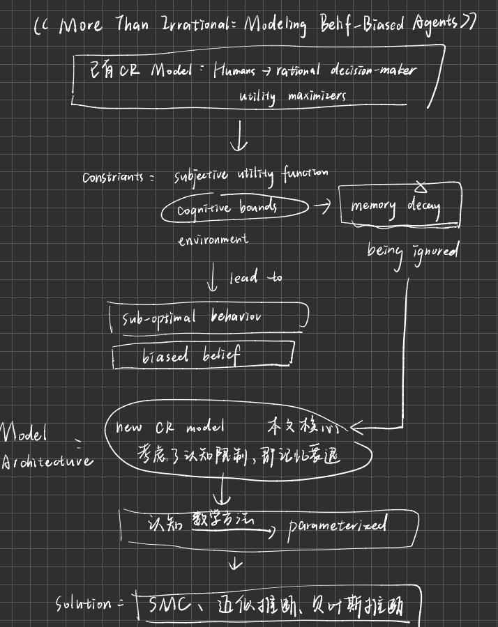
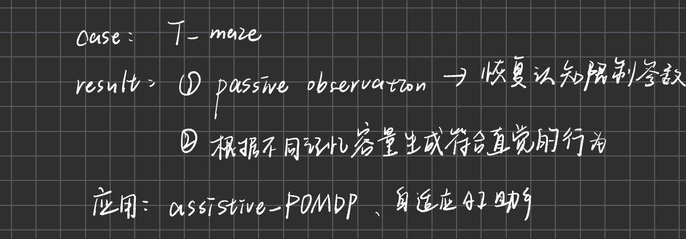
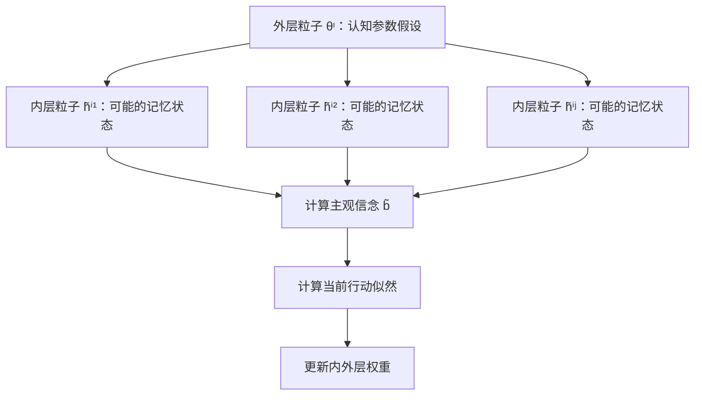
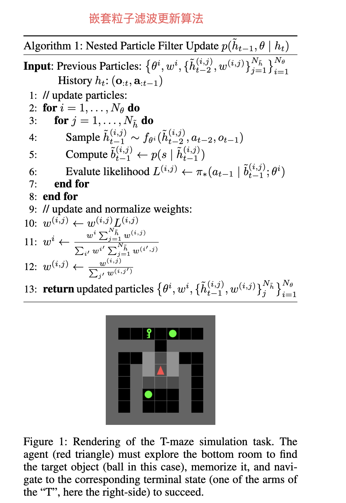
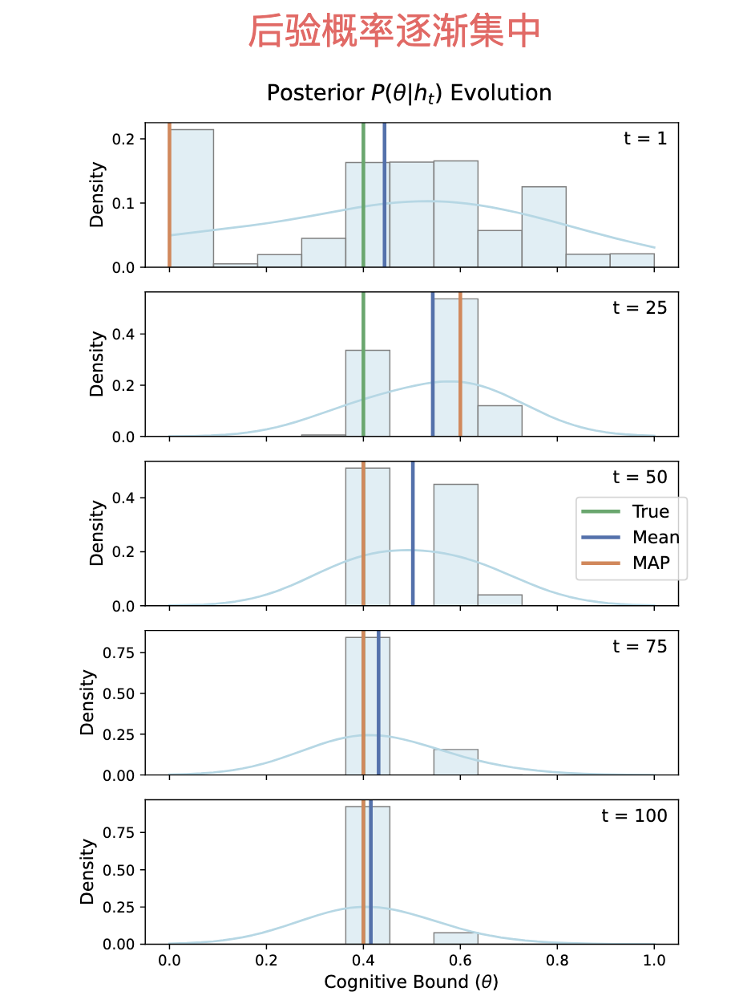
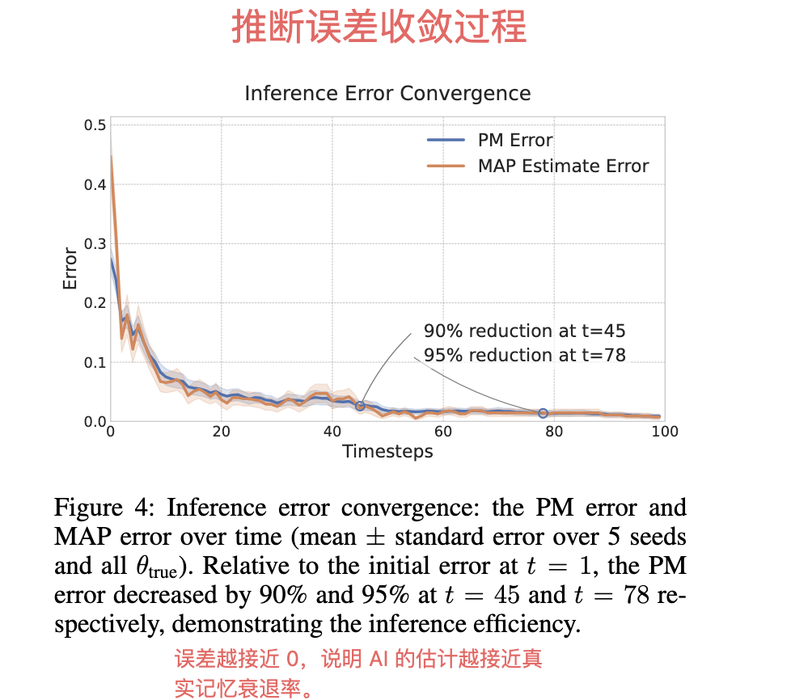

---
tags:
  - papers/human-ai-collaboration
  - computational-rationality
  - bounded-memory
  - particle-filtering
aliases:
  - More Than Irrational
  - 信念偏差智能体
date: 2026-10-25
paper_type: AI user modeling
status: reading-note
Code: https://github.com/Yifan-Zhu/More-ThanIrrational-Modeling-Belief-Biased-Agents
Extended version: https://www.arxiv.org/abs/2511.12359
---

# More Than Irrational: Modeling Belief-Biased Agents

> [!info] 一句话总结
> 用户看起来“不理性”，可能只是因为记忆有限，形成了偏差信念；用户仍会在自己的主观信念下理性决策。论文用计算理性（CR）模型描述这一过程，并用嵌套粒子滤波（NPF）在线推断用户的记忆衰退参数与内部信念状态。

## 1. 论文信息

- **主题**：人机协同、计算理性、有限记忆用户建模、在线贝叶斯推断
- **核心任务**：只观察用户的行动，推断用户的认知限制与当前信念，并据此调整 AI 辅助
- **实验环境**：T-maze 部分可观测导航任务
- **主要认知限制实例**：记忆衰退率 $\theta$
- **核心算法**：Nested Particle Filtering（嵌套粒子滤波，NPF）

## 2. 研究问题与核心洞见

### 2.1 研究问题

在用户记忆不完善、行为看起来不理性的情况下，AI 如何：

1. 推断用户的目标、信念与下一步行动？
2. 在线识别用户特有的记忆限制？
3. 区分“需要直接行动建议”和“只需要温和记忆提示”的用户？




### 2.2 核心洞见


关键不是把行为直接标成“非理性”，而是解释：

> 用户的行动可能是基于错误信念的理性行动。

## 3. 预备知识：POMDP 与完全理性决策

### 3.1 POMDP 定义

论文把不确定环境中的连续决策建模为部分可观测马尔可夫决策过程（POMDP）：

$$
M=(S,A,T,R,O,\Omega,\gamma)
$$

| 符号 | 含义 |
|---|---|
| $S$ | 环境状态空间；真实状态的所有可能取值 |
| $A$ | 行动空间；智能体可以采取的行动 |
| $T(s'|s,a)$ | 状态转移模型；执行 $a$ 后从 $s$ 到 $s'$ 的概率 |
| $R(s,a)$ | 奖励函数；行动结果的好坏 |
| $O(o|s)$ | 观察模型；真实状态 $s$ 产生观察 $o$ 的概率 |
| $\Omega$ | 观察空间 |
| $\gamma$ | 折扣因子，控制未来奖励的重要程度 |

### 3.2 贝叶斯信念更新

完全理性（FR）智能体能够准确维护信念状态 $b_t$：

$$
b_t(s_t)=p(s_t|o_t,a_{t-1},b_{t-1})
\propto O(o_t|s_t)\sum_{s_{t-1}}T(s_t|s_{t-1},a_{t-1})b_{t-1}(s_{t-1})
$$

直观解释：智能体把“过去的信念”“行动后的环境变化”和“新观察”结合起来，更新对真实状态的概率判断。

### 3.3 策略与动作价值

完全理性智能体学习最优策略：

$$
\pi^{*}(a|b)\propto \exp(\tau Q^{*}(b,a))
$$

- $\pi^{*}$：策略，即在信念 $b$ 下采取行动 $a$ 的概率；
- $Q^{*}(b,a)$：动作价值函数，表示在 $b$ 下采取 $a$ 的长期预期收益；
- $\tau$：逆温度参数。$\tau$ 越大，越偏向高价值行动；越小，行动越随机。

## 4. 计算理性用户模型（CR）

### 4.1 记忆形成与破坏

用户不会直接使用真实历史，而是通过有限记忆过程形成内部记忆：

$$
\tilde h_t\sim f_\theta(\tilde h_{t-1},o_t,a_{t-1})
$$

- $\tilde h_t$：用户在时间 $t$ 的内部记忆状态；
- $f_\theta$：认知/记忆更新模型；
- $\theta$：用户特有的认知参数，如记忆衰退率；
- 波浪号 $\tilde{\ }$：表示用户记忆中的版本，可能已经被遗忘或篡改。

例如，真实看到的是绿色球，但经过记忆衰退后，用户可能忘记目标，或把目标记成钥匙。

### 4.2 基于主观信念的贝叶斯更新

CR 用户根据自己的内部记忆而不是完整真实历史计算信念：

$$
\tilde b_t=p(s_t|\tilde o_{1:t},\tilde a_{1:t-1})
$$

这意味着用户形成的是主观信念 $\tilde b_t$，它可能偏离客观世界的信念 $b_t$。

由于过去记忆可能在之后发生变化，用户的信念可能被“追溯性”修改；因此不能简单地只用上一步信念做一阶更新，而需要考虑整段可能有错误的记忆历史。

### 4.3 在偏差信念下仍然理性

CR 用户的行动策略是：

$$
\pi^{*}(a|\tilde b;\theta)=
\frac{\exp(\tau Q^{*}(\tilde b,a;\theta))}
{\sum_{a'\in A}\exp(\tau Q^{*}(\tilde b,a';\theta))}
$$

用户根据自己的 $\tilde b$ 选择最有价值的行动，因此从用户视角是理性的；但外部观察者知道真实信念 $b^*$，会发现：

$$
Q^{*}(b^{*},a^{CR})<Q^{*}(b^{*},a^{FR})
$$

即基于偏差信念的行动，在客观世界中可能是次优的。

## 5. 在线推断：联合估计认知参数与内部记忆

### 5.1 推断目标

AI 观察用户的行动—观察历史：

$$
h_t=(o_{1:t},a_{1:t-1})
$$

目标是估计联合后验：

$$
p(\tilde h_{t-1},\theta|h_t)
$$

它同时回答：

- 用户的记忆衰退参数 $\theta$ 可能是多少？
- 在该参数下，用户当前可能记得什么？

贝叶斯分解的直观形式为：

$$
p(\tilde h_{t-1},\theta|h_t)
\propto
p(a_{t-1}|\tilde h_{t-1})
\times p(\tilde h_{t-1}|\tilde h_{t-2},h_{t-1},\theta)
\times p(\tilde h_{t-2},\theta|h_{t-1})
$$

三项分别是：

1. **用户行动似然**：当前内部记忆下，用户采取当前行动的可能性；
2. **记忆转移项**：旧记忆在新观察后如何变化；
3. **上一时刻后验**：上一轮已经得到的估计结果。

## 6. 嵌套粒子滤波（NPF）

### 6.1 双层粒子结构

NPF 用两层粒子近似联合分布：



- 外层粒子数量：$N_\theta$；每个粒子代表一个可能的认知参数；
- 内层粒子数量：$N_{\tilde h}$；每个粒子代表该参数下的一种可能内部记忆；
- 权重越高：越能解释观察到的用户行为。

### 6.2 算法流程

```text
输入：上一时刻的外层粒子、内层记忆粒子及其权重；新的行动-观察历史

for 每个外层参数粒子 θᶦ：
    for 每个内层记忆粒子 h̃ⁱʲ：
        1. 用 fθᶦ 更新记忆状态 h̃ⁱʲ
        2. 根据 h̃ⁱʲ 计算主观信念 b̃ⁱʲ
        3. 计算该信念下产生当前行动的概率 Lⁱʲ
        4. 用 Lⁱʲ 更新内层权重
    5. 汇总该 θᶦ 下所有内层粒子的表现，更新外层权重
6. 分别归一化内层和外层权重
输出：更新后的 θ、记忆状态、权重
```

### 6.3 为什么需要“嵌套”

如果只估计 $\theta$，无法解释用户此刻到底记得什么；如果只估计记忆状态，又无法识别用户长期的记忆能力。

NPF 同时处理：

```text
外层：用户总体上有多容易忘记？
内层：在这个遗忘能力下，用户现在具体记得什么？
```

### 6.4 复杂度

精确推断的计算量约为：

$$
O(|S|^t t!)
$$

会随时间快速增长。NPF 的计算量约为：

$$
O(N_\theta N_{\tilde h}t|S|)
$$

因此使用有限粒子后可以支持在线/实时推断。

## 7. T-maze 实验

### 7.1 任务

智能体从走廊出发，必须：

1. 进入底部房间；
2. 观察目标物体；
3. 记住目标；
4. 经过一段走廊；
5. 到达与目标物体一致的顶部终点。

智能体可以向四个方向移动或停留；每次只能观察周围 $3\times3$ 的网格。到达正确终点获得奖励，否则奖励为 0。

### 7.2 记忆衰退参数

每一步，目标记忆以概率 $\theta$ 被替换为默认值：

- $\theta=0.0$：完美记忆，直接寻找并到达正确终点；
- $\theta=0.4$：中度遗忘，多收集几次目标信息；
- $\theta=0.7$：严重遗忘，可能出现“忘记—返回重查”；
- $\theta=1.0$：完全没有记忆，无法依靠目标信息，只能随机猜测。

### 7.3 关键图：不同记忆能力下的轨迹

论文 Figure 2 展示了四种轨迹：

| 记忆能力 | 典型行为    | 解释           |
| ---- | ------- | ------------ |
| 完美记忆 | 观察一次后直达 | 客观最优         |
| 中度遗忘 | 多观察几次   | 用额外观察弥补记忆风险  |
| 严重遗忘 | 遗忘后返回重查 | “遗忘—重新检查”循环  |
| 无记忆  | 不探索，直接猜 | 记住也没用，因此随机选择 |

轨迹颜色表示时间顺序：越亮越早，越红越晚；网格深浅表示访问频率，越深表示反复访问越多。

## 8. 推断实验结果

### 8.1 Figure 3：后验如何收敛

实验设置真实参数 $\theta_{true}=0.4$。

- 绿色线：真实值；
- 蓝色线：后验均值；
- 橙色线：MAP（最大后验估计）；
- 柱状图：粒子权重分布；
- 横轴：可能的认知参数；
- 纵轴：后验概率密度。

随着观察从 $t=1$ 增加到 $t=100$，分布从分散逐渐集中到 $0.4$ 附近，说明 AI 逐渐排除不符合行为的参数假设。

### 8.2 Figure 4：误差收敛


Figure 4 显示 PM Error 和 MAP Estimate Error 随观察步数下降。

主要结果：

- 最终 PM 误差：$0.0087\pm0.0035$；
- 误差在前 20–30 步下降最快；
- 第 45 步，PM 误差相对初始误差下降约 90%；
- 第 78 步，下降约 95%。

这表明用户的行为中包含足够信息，使认知参数在有限观察下具有可识别性。

## 9. 自适应 AI 辅助

作者进一步把问题写成辅助型 POMDP：

- AI 能看到环境状态；
- AI 能看到用户行动；
- AI 看不到用户内部记忆状态和认知参数；
- AI 需要选择是否干预以及采用哪种干预。

辅助动作有三类：

1. **No Assistance**：不干预；
2. **Memory Hint**：提醒之前看到的关键信息；
3. **Action Hint**：直接告诉用户应该采取什么行动。

自适应策略：

| 用户记忆衰退 | AI 策略 |
|---|---|
| $\theta\leq0.3$ | 很少干预 |
| $0.4\leq\theta\leq0.8$ | 提供适时记忆提示，也可能给行动提示 |
| $\theta\geq0.9$ | 记忆提示可能马上被忘记，因此关键时刻提供直接行动提示 |

这体现了“根据用户状态调整辅助强度”，而不是对所有用户使用同一种提示策略。

## 10. 论文贡献

1. **提出 CR 用户模型**：把有限记忆、偏差信念和次优行动连接起来。
2. **显式建模记忆变化**：用 $f_\theta$ 描述记忆如何被遗忘或破坏。
3. **提出 NPF 在线推断方法**：同时估计静态认知参数与动态内部记忆。
4. **在 T-maze 中验证表达能力**：不同 $\theta$ 生成可解释的行为模式。
5. **验证数据效率**：不需要很长行为序列即可有效估计用户参数。
6. **展示自适应辅助应用**：AI 学会区分不干预、记忆提示和直接行动建议。

## 11. 局限性与边界

- 用户模型和推断方法假设已知环境动态 $T$ 与观察模型 $O$；现实中环境模型可能未知或不准确。
- 实验只采用一种简单的记忆衰退模型，不能覆盖真实用户复杂的记忆、注意力和动机变化。
- 行为相似会造成可识别性问题：不同认知参数可能产生相同或相似行动。
- 模拟环境中的“真实参数”由研究者预先设定；现实中通常不存在可直接读取的标准答案。
- 用户的错误行动也可能来自疲劳、分心、目标改变或视觉误差，不能全部归因于记忆衰退。

## 12. 可复现要点

- 环境：T-maze 网格世界；
- 隐藏状态：位置 + 目标物体；
- 观察：智能体周围 $3\times3$ 网格；
- 行动：四个方向移动或停留；
- 关键参数：$\theta\in\{0.0,0.1,\ldots,1.0\}$；
- 推断粒子：外层认知参数粒子 + 内层记忆状态粒子；
- 训练：PPO 预训练不同 $\theta$ 下的行动策略；
- 评价：PM error、MAP error、后验收敛速度；
- 辅助：用 NPF 维护用户隐藏状态的信念，再优化辅助策略。

## 13. 个人理解版

这篇论文可以类比为 AI 观察一个人在迷宫中找东西：

```text
人反复检查同一个位置
        ↓
AI 不急着判断“他不理性”
        ↓
AI 考虑：他是不是忘记了刚才的信息？
        ↓
维护多个可能的记忆能力和内部记忆
        ↓
比较哪种假设最能解释当前行动
        ↓
逐渐识别用户的记忆限制
        ↓
选择不打扰、提醒记忆，或直接给行动建议
```

## 14. 相关概念索引

- [[计算理性 Computational Rationality]]
- [[部分可观测马尔可夫决策过程 POMDP]]
- [[贝叶斯滤波 Bayesian Filtering]]
- [[粒子滤波 Particle Filtering]]
- [[人机协同 自适应辅助]]

## 15. 总体算法


> [!note] 图像说明
> 上图是本论文的框架化笔记：从 POMDP 预备知识出发，经由 CR 用户模型产生偏差信念，再用在线贝叶斯推断和 NPF 同时估计认知参数与内部记忆，最后用于自适应 AI 辅助。

## 16. 原论文文件

- [原始 PDF](<../../../../Library/Containers/com.tencent.xinWeChat/Data/Documents/xwechat_files/wxid_awjlkm43743o22_17b8/temp/drag/AI research(1).pdf>)
