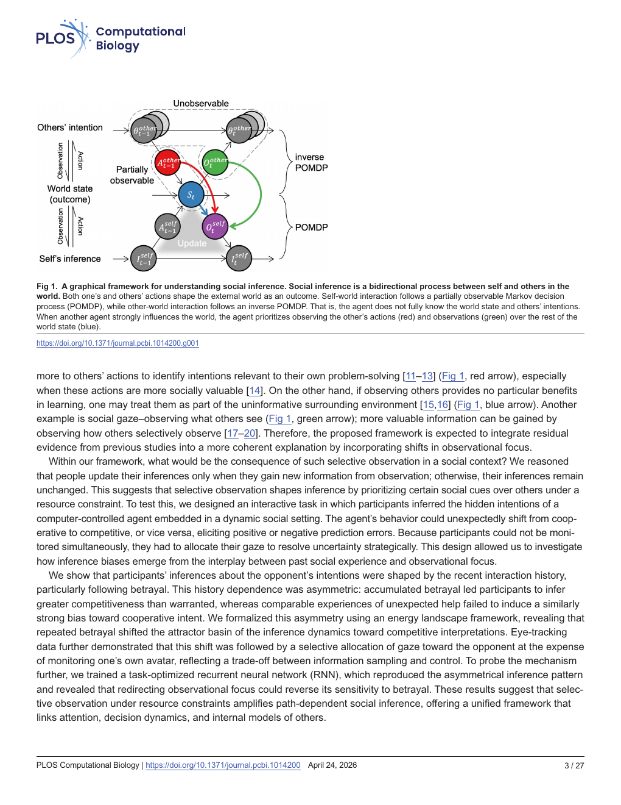
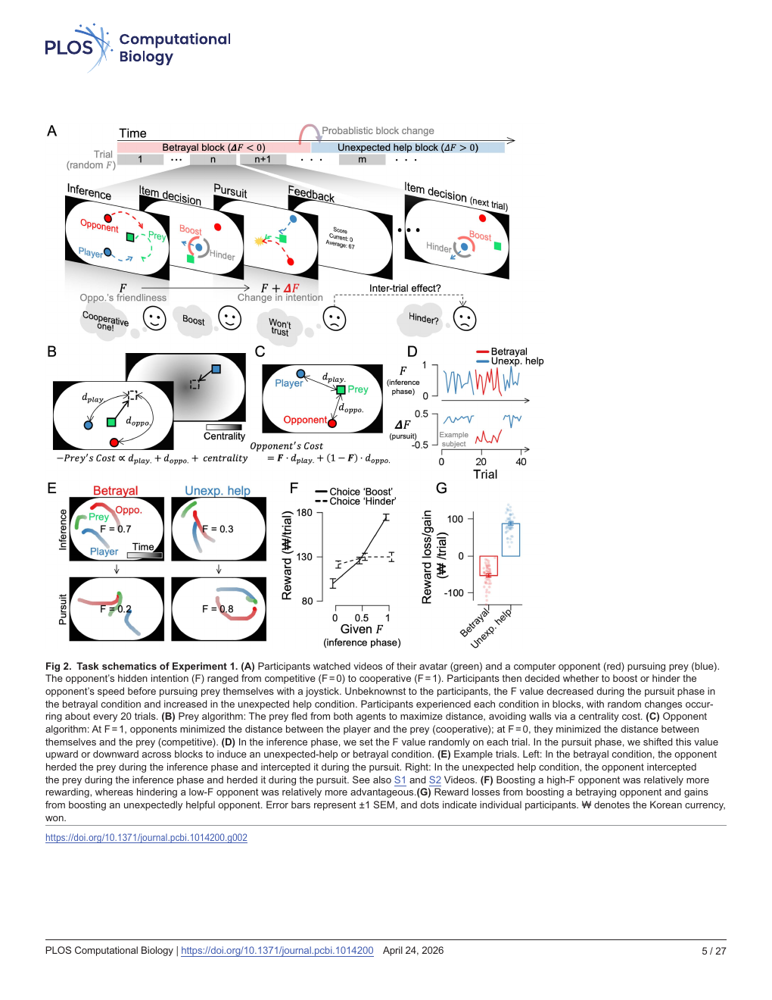
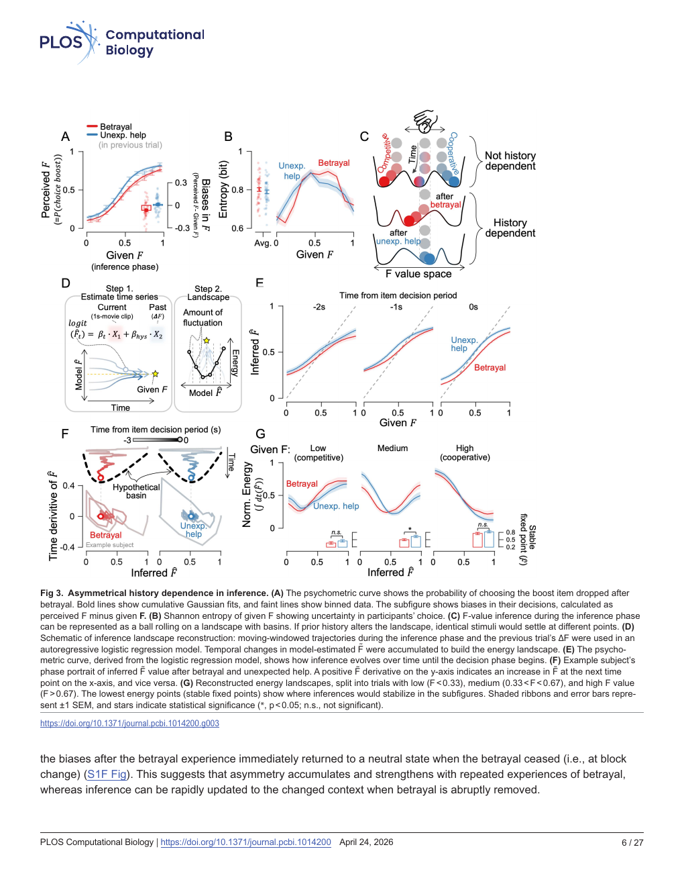
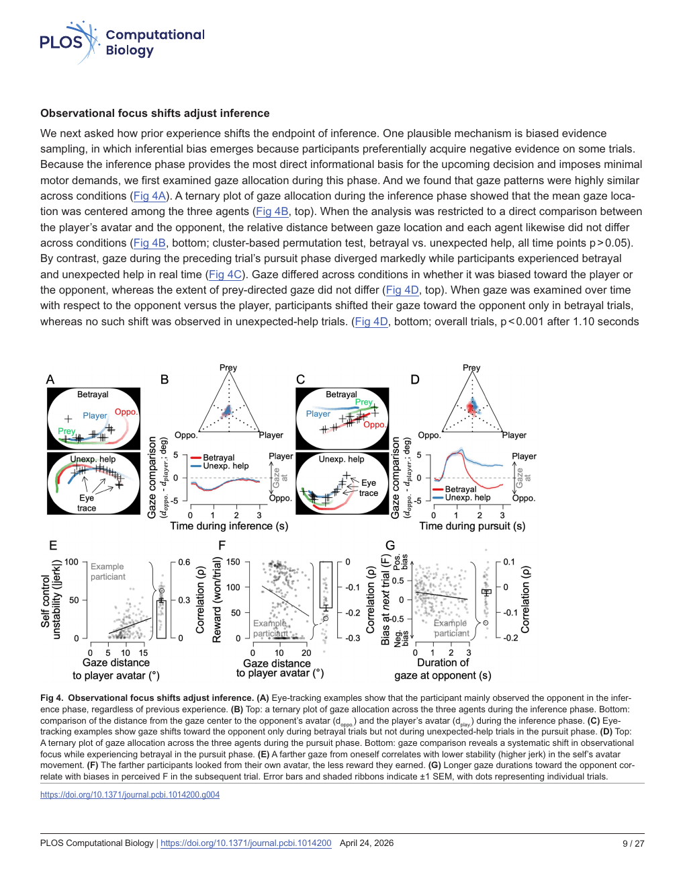
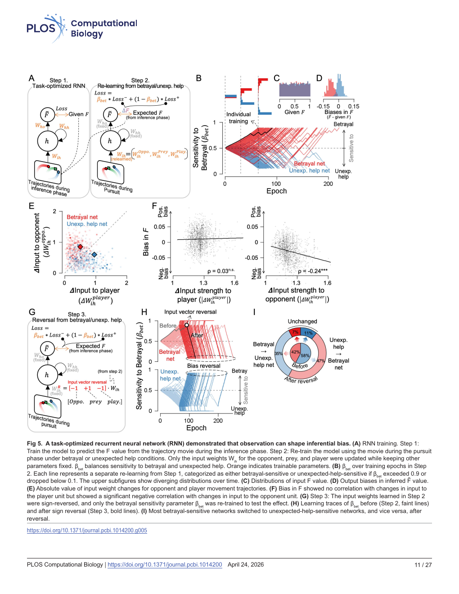
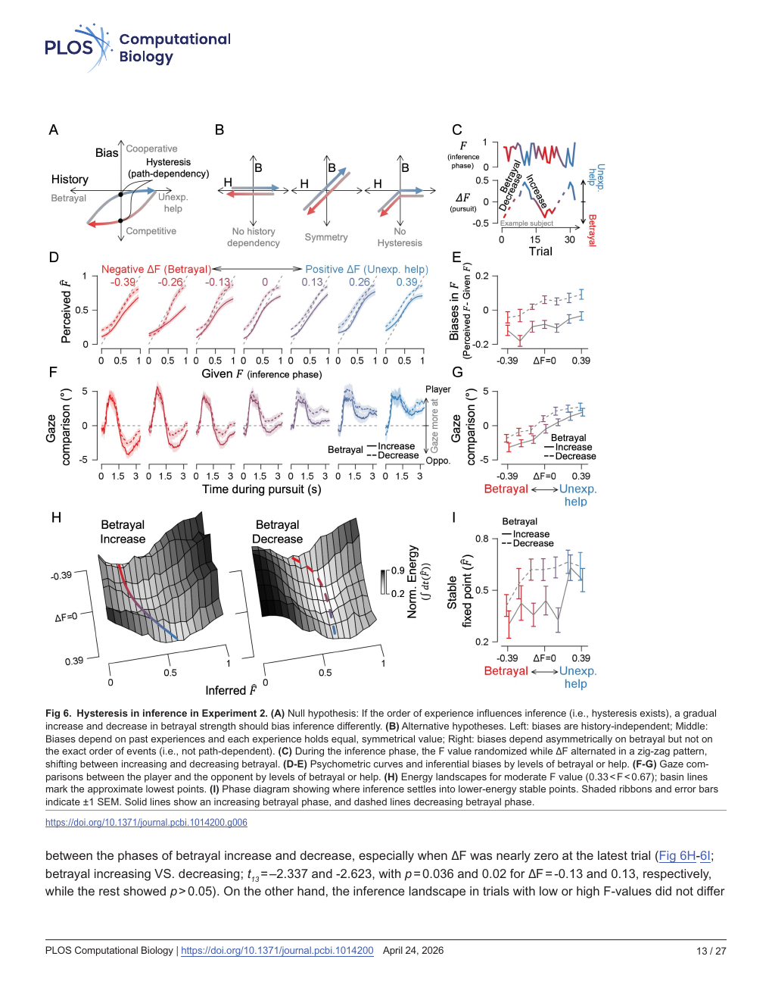
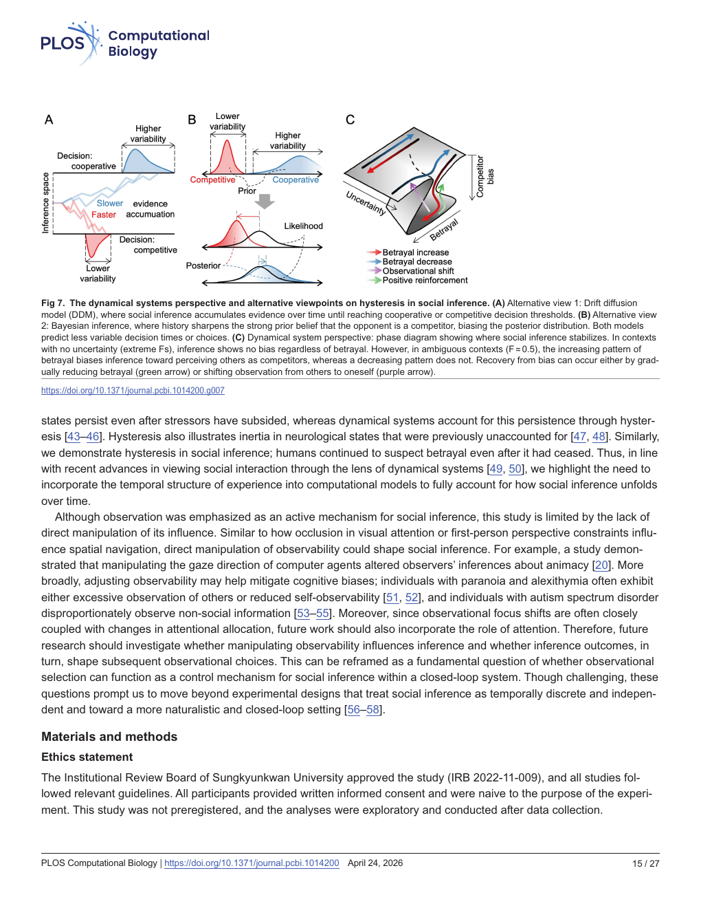

> [!info] 论文信息
> - 作者：Sangkyu Son; Seng Bum Michael Yoo
> - 期刊：PLOS Computational Biology，2026，22(4): e1014200
> - DOI：[10.1371/journal.pcbi.1014200](https://doi.org/10.1371/journal.pcbi.1014200)
> - 代码：[socialObservationHysteresis](https://github.com/SangkyuSon/socialObservationHysteresis)
> - 数据集：[Zenodo 17986013](https://doi.org/10.5281/zenodo.17986013)
> - 论文类型：行为实验 + 计算建模 / 动力系统分析
> - 证据范围：完整 PDF；本文档以论文、图表和方法部分为依据，外部领域史未单独核验。
> - Source coverage: Full paper
> - Extraction confidence: Mixed（PDF 文本层可提取；部分公式按版面重建）
> - Locator mode: structure-grounded
> - Primary analytical lens: methods
> - Secondary analytical lens: discovery
> - Context verification: Paper-only
> - Card completeness: Complete relative to supplied source

## 专业名词总表（中英文对照）

| English | 中文与解释 |
|---|---|
| social inference | 社会推断：从他人的行为和结果推断其意图、目标或心理状态 |
| selective observation | 选择性观察：在有限注意力下优先观察部分对象或线索 |
| observability | 可观察性：某个状态或行为能够被观察和获取的程度 |
| partial observability | 部分可观察性：只能获得环境或他人状态的一部分信息 |
| hidden / latent intention | 隐藏 / 潜在意图：不能直接观察，只能由行为反推的目标 |
| betrayal | 背叛：对手行为从预期的合作转向竞争 |
| unexpected help | 意外帮助：对手行为从预期的竞争转向合作 |
| hysteresis | 滞后性：当前状态取决于当前输入及过去经历的路径 |
| path dependence | 路径依赖：相同当前刺激因历史顺序不同而产生不同结果 |
| inference landscape | 推断景观：用能量地形表示推断状态及其稳定性的框架 |
| attractor basin | 吸引子盆地：动态系统趋向某个稳定推断的区域 |
| stable fixed point | 稳定定点：推断动力学最终趋于稳定的位置 |
| psychometric curve | 心理测量曲线：刺激强度与选择概率之间的函数关系 |
| Shannon entropy | 香农熵：量化选择不确定性的指标，最大值表示最不确定 |
| signal detection theory | 信号检测理论：区分感知敏感性与决策标准的分析框架 |
| sensitivity, d′ | 敏感性：区分不同意图证据的能力 |
| decision criterion, c | 决策标准：倾向作出某种判断所需的证据阈值 |
| autoregressive logistic regression | 自回归逻辑回归：用当前时间窗和历史变量预测下一步二元选择 |
| recurrent neural network, RNN | 循环神经网络：带有内部状态、能处理时间序列的网络 |
| LSTM | 长短期记忆网络：能保留长期时间依赖的 RNN 单元 |
| input weight | 输入权重：某类输入对网络内部表征和输出的影响强度 |
| observation-resource trade-off | 观察资源权衡：观察他人有助于推断，但会削弱对自身角色的监控与控制 |
| jerk | 加加速度：轨迹的三阶时间导数，用于衡量控制动作的平滑性/稳定性 |

## 01 基本信息

研究对象是人类如何在只能**部分观察他人行为**的情况下，**推断他人的隐藏意图**。实验把社会推断嵌入一个二维追捕游戏：参与者、计算机对手和猎物同时运动；参与者先观察，再决定增强或削弱对手速度。

## 02 一句话总结

论文显示，背叛会使人们在后续社会推断中更偏向把他人解释为竞争者，而对手相关的选择性观察会放大这一偏差；这一过程可由能量景观、眼动数据和任务优化型 RNN 共同解释为具有路径依赖的社会推断动力学。

## 03 研究问题

1. 人们在只能看到部分社会信息时，如何选择观察对象？
2. 选择观察对手还是自己，是否会改变对他人意图的推断？
3. 背叛与意外帮助是否对后续推断产生对称影响？
4. 当前偏差是否取决于过去经历的顺序，即是否存在 hysteresis / 滞后性？

## 04 背景与发展路径

论文将社会推断放在三个传统框架的交叉处：

1. **逆问题（inverse problem）**：从行动反推潜在目标。
2. **贝叶斯推断（Bayesian inference）**：由观察到的行动更新目标的后验概率。
3. **逆强化学习（inverse reinforcement learning, IRL）**：由行动序列推断他人的价值函数。

作者指出，既有模型经常隐含假设“所有行动都被观察到”。本研究将观察本身建模为有限、选择性的资源，并引入动力系统视角来解释历史顺序和滞后性。[Paper: Introduction]

## 05 论文识别的核心痛点

| 痛点        | 具体表现                  | 论文解释          | 证据                   |
| --------- | --------------------- | ------------- | -------------------- |
| 观察并非完整    | 人不能同时监控所有行动           | 注意和视线资源有限     | 引言、Fig. 1、Fig. 4     |
| 社会推断受历史影响 | 同一 F 值在不同历史后得到不同判断    | 过去互动改变内部推断动力学 | Fig. 3、Fig. 6        |
| 背叛与帮助不对称  | 背叛造成竞争性偏差，帮助未造成同等合作偏差 | 参与者在背叛后更多观察对手 | Fig. 3、Fig. 4、Fig. 5 |
| 传统静态模型不足  | 难以解释事件顺序和偏差持续         | 需要能量景观和路径依赖框架 | Fig. 6、Fig. 7        |

## 06 核心思想与创新

### 表层方法

设计一个可精确操控对手潜在意图的互动追捕任务，并结合行为选择、奖励、眼动、能量景观重建和 RNN 模拟。

### 论文的主要创新

1. **把观察行为纳入社会推断模型**：不仅研究“看到什么之后如何判断”，还研究“选择看什么如何改变判断”。
2. **提出观察资源权衡**：对手观察增加时，自身 avatar 的监控和控制可能下降。
3. **揭示背叛/帮助不对称性**：负面经历对竞争性推断的影响强于正面经历对合作性推断的影响。
4. **用能量景观表示推断偏差**：背叛主要移动吸引子盆地的位置，而不是简单地加深盆地、提高确信度。
5. **检验 hysteresis**：背叛强度上升和下降时，即使当前刺激相同，推断仍不同。
6. **用任务优化型 RNN 连接观察与偏差**：改变对手/自我输入权重即可使网络从背叛敏感型切换为意外帮助敏感型。

## 07 方法总览

```text
三角色轨迹视频
  -> 参与者自由观察并形成对 F 的判断
  -> 2AFC：boost 或 hinder 对手
  -> 追捕阶段实际改变 F，制造 betrayal / unexpected help
  -> 奖励、下一轮选择和眼动反馈
  -> 心理测量曲线、熵、回归、能量景观
  -> RNN 模拟观察权重与推断偏差
```

### 参与者与装置

- 总计 62 人：35 男、27 女，年龄 $23.3\pm2.9$。
- Experiment 1：48 人；Experiment 2：14 人；Experiment 1 中另有 8 人独立复测。
- 24 英寸 LCD，1920×1080，60 Hz；右眼 EyeLink 1000 Plus，1 kHz 记录，后降采样到 60 Hz。
- MATLAB + Psychophysics Toolbox；Logitech Extreme Pro 3D joystick。

### 一次试验的四阶段

1. **Inference phase（推断阶段）**：观看平均 2.3 s 的三角色轨迹视频。
2. **Item decision phase（项目决策阶段）**：通过 joystick 选择 boost 或 hinder。
3. **Pursuit phase（追捕阶段）**：控制自己的 avatar 捕获猎物，最长 15 s。
4. **Feedback phase（反馈阶段）**：按捕获速度和结果获得分数。

## 08 核心模块拆解

| 模块 | 功能 | 输入/输出 | 关键作用 |
|---|---|---|---|
| Prey algorithm（猎物算法） | 同时逃避玩家和对手并避免靠近边界 | 15 个候选位置 -> 下一位置 | 维持任务难度和社会互动结构 |
| Opponent algorithm（对手算法） | 由 F 控制合作或竞争行为 | 角色位置、F -> 对手下一位置 | 直接操控潜在意图 |
| Player avatar algorithm | 推断阶段按预设轨迹运动 | 猎物历史位置 -> 预测位置 | 减少运动控制对推断阶段的干扰 |
| Betrayal manipulation | 追捕阶段降低 F | 推断阶段 F 与追捕阶段 F 的差值 $\Delta F<0$ | 制造负向预测误差 |
| Unexpected-help manipulation | 追捕阶段提高 F | $\Delta F>0$ | 制造正向预测误差 |
| Eye tracking | 记录观察资源分配 | 眼位与三角色位置 -> gaze allocation | 检验观察重点是否改变 |
| Energy landscape | 重建推断动态稳定结构 | $\tilde F$ 时间序列 -> $U(\tilde F)$ | 区分盆地位置、深度和陡峭度 |
| Task-optimized RNN | 模拟意图预测与历史适应 | 轨迹序列 -> $\tilde F$ | 测试观察权重能否产生偏差 |

### 对手算法

对每个候选位置计算预测猎物位置，并定义：

$$
C_{opponent}=F\,d_{play}+(1-F)\,d_{oppo}
$$

- $F\in[0,1]$：friendliness / 友好度参数。
- $d_{play}$：预测猎物到玩家的距离。
- $d_{oppo}$：预测猎物到对手的距离。
- $F=1$：对手把猎物赶向玩家，表现为 shepherding / 驱赶协作。
- $F=0$：对手把猎物截向自己，表现为 competitive interception / 竞争性拦截。

### 猎物算法

猎物每次从 15 个相隔 24° 的候选位置中选择，综合 escape cost（逃避代价）和 centrality cost（中心性代价）：

$$
C_{prey}=0.6C_{escape}+0.4C_{centrality}
$$

并选择综合代价最低的位置；对手距离小于 25° 时，猎物以最大速度 1.95°/s 逃跑，超过 50° 后速度按 sigmoid function / S 形函数下降。

### Experiment 1 / Experiment 2

- **Experiment 1**：每约 20 次试验形成 betrayal 或 unexpected-help block，$\Delta F$ 分别约为 $-0.35$ 至 $-0.45$、$+0.35$ 至 $+0.45$。
- **Experiment 2**：让 $\Delta F$ 在 9 次试验中逐渐增加或减少，形成 betrayal-increasing / betrayal-decreasing phase，用于检验滞后性。

## 09 关键公式与符号

### 1. 选择与推断偏差

将 boost 选择编码为 1，hinder 编码为 0。论文用“感知到的 F - 给定 F”定义偏差：

$$
Bias=\tilde F-F
$$

- $Bias<0$：竞争性偏差。
- $Bias>0$：合作性偏差。

### 2. Shannon entropy / 香农熵

论文将 boost 概率转换为选择不确定性：

$$
H=-p( boost )\log_2 p( boost )
$$

严格的二元熵形式还应包含另一选择项 $-(1-p)\log_2(1-p)$；论文正文给出的排版公式显示为 boost 项。概念上，$p=0.5$ 时不确定性最大，$p=0$ 或 $1$ 时最小。[Paper: Materials and methods, Analysis of item choice and reward]

### 3. 自回归逻辑回归

论文用于预测下一次 boost 选择：

$$
\operatorname{logit}P( boost_t)=\beta_0+\beta_tX_t+\beta_{hys}\Delta F_{prev}+\epsilon
$$

- $X_t$：当前推断视频中的三角色两两欧氏距离特征。
- $\beta_t$：当前轨迹对推断的影响。
- $\Delta F_{prev}$：上一试验意图变化量。
- $\beta_{hys}$：历史经历对偏差的影响。

每 200 ms 汇总一次，1 s 窗口得到 5 个时间点 × 3 个角色对 = 15 个轨迹特征。

### 4. 能量景观

根据推断状态的时间导数构建：

$$
U(\tilde F)=\int g(\tilde F)\,d\tilde F,
\qquad g(\tilde F)=\frac{d\tilde F}{dt}
$$

- 低能量点：稳定定点 / stable fixed point。
- 盆地深度：最大能量与最小能量之差，近似反映稳定性。
- 盆地位置：决策标准移动的位置。
- 盆地陡峭度：稳定点两侧拟合斜率中较大的一个。

### 5. Signal Detection Theory

$$
d'=Z(hit\ rate)-Z(false\ alarm\ rate)
$$

$$
c=-\frac{1}{2}[Z(hit\ rate)+Z(false\ alarm\ rate)]
$$

$d'$ 表示敏感性，$c$ 表示决策标准。结果表明背叛后主要是 $c$ 移动，而非 $d'$ 降低。

### 6. RNN 损失函数

第一阶段用均方误差预测 F：

$$
MSE=\sum_{trial}(F_{predict}-F_{actual})^2
$$

第二阶段用 $\beta_{bet}$ 平衡背叛与意外帮助：

$$
MSE=\beta_{bet}Loss^-+(1-\beta_{bet})Loss^+
$$

$\beta_{bet}=1$ 表示只学习背叛试验，$\beta_{bet}=0$ 表示只学习意外帮助试验，初始值为 0.5。

## 10 实验与证据链

| 实验 | 检验问题 | 主要结果 | 支持的结论 |
|---|---|---|---|
| Fig. 2，任务验证 | 参与者是否理解合作/竞争并据此获利 | 高 F 时 boost、低 F 时 hinder 更有利；背叛时 boost 造成损失，意外帮助时 boost 获益 | 任务能诱发真实的策略性社会推断 |
| Fig. 3A | 历史是否改变同一 F 的判断 | 背叛后 boost 概率下降；意外帮助后无系统性偏差 | 历史效应不对称 |
| Fig. 3B | 是否只是整体不确定性变化 | 平均熵无差异，但不同 F 区间的熵发生相反变化 | 内部不确定性景观发生选择性重排 |
| Fig. 3C-G | 偏差改变能量盆地的什么属性 | 盆地最低点向较低 F 移动；深度/陡峭度基本不变 | 背叛改变决策标准，而非单纯降低信心 |
| Fig. 4 | 观察重点是否改变 | 背叛后更多观察对手，意外帮助后更多观察自身 avatar | 观察资源分配与后续偏差相关 |
| Fig. 5 | 观察权重是否足以产生偏差 | 对手输入权重变化与负偏差相关；反转自我/对手权重可反转敏感性 | 观察输入通道可能是偏差机制 |
| Fig. 6 | 是否存在 hysteresis | 背叛强度上升期偏差大于下降期，尤其在中等 F | 事件顺序影响当前推断 |
| Fig. 7 | 与 DDM/Bayesian 模型相比 | 数据不支持简单的反应时/选择变异下降；动力系统解释更匹配 | 需要保留时间结构和路径依赖 |

### 关键混淆因素排除

- 奖励差异不能解释不对称性：意外帮助的收益差异反而更大。
- 先前奖励大小与下一轮感知 F 无显著关系。
- 在 just noticeable difference（JND，刚可觉差）范围内，背叛与意外帮助仍有差异，反对纯粹的策略性报告。
- 事后位置、速度、加速度、两两距离和角度等运动学特征匹配，说明差异更可能来自内部计算而非刺激统计。
- 决策时间与偏差无显著关联。

## 11 结论的正确边界

### 论文支持的结论

1. 背叛经历后，参与者更倾向于把对手解释为竞争者。
2. 该偏差在重复背叛时增强，但在 block 改变后可快速回到中性状态。
3. 背叛后，观察资源更多分配给对手，且自身 avatar 的控制稳定性下降。
4. 推断偏差主要表现为决策标准移动，不是一般性的感知敏感性下降。
5. 背叛强度的上升/下降顺序会改变同一当前状态下的推断，符合 hysteresis。

### 论文没有直接证明的内容

- 没有直接操控“可观察性”本身，因此眼动变化与推断偏差的因果关系仍有限。
- RNN 的权重变化是机制模拟，不等同于人脑中真实的神经连接变化。
- 该任务中的二维追捕结果不能直接推广到所有现实社会关系。
- 研究显示的是行为关联和计算解释，不足以单独证明观察转移必然导致偏差。

## 12 作者明确提到的局限

作者明确指出，研究尚未直接操控 observation / observability 的影响；未来需要直接操控遮挡、视线方向或可观察性，并研究“观察选择是否能作为社会推断的闭环控制机制”。研究还提出应进一步纳入 attention / 注意分配，并使用更自然、闭环的社会互动环境。[Paper: Discussion, Fig. 7]

另一个方法学信息是：研究未预注册，分析在数据收集后以探索性方式进行。[Paper: Materials and methods, Ethics statement]

## 13 批判性分析

| [Analysis] 观察 | 替代解释 | 如何检验 |
|---|---|---|
| 背叛后更看对手并伴随偏差 | 背叛可能引发一般性警觉，而非特异性社会推断改变 | 增加非社会威胁条件、测量生理唤醒和一般注意 |
| 观察与偏差相关 | 偏差也可能先出现，再驱动视线转向对手 | 操控 gaze target 或遮挡，检验因果方向 |
| RNN 权重反转可反转偏差 | 这是模型内部的可实现机制，不保证是人类唯一机制 | 比较贝叶斯、DDM、主动推断模型和 RNN 的预测 |
| 盆地移动被解释为决策标准改变 | 能量景观重建依赖自回归模型和拟合形式 | 用独立数据、非参数动力学模型复现 |
| 负面经历影响更强 | 可能与社会损失、威胁或进化相关性有关 | 匹配负/正价值、威胁强度和可预测性 |

## 14 可迁移知识

### Agent-derived knowledge candidates

1. 观察是社会推断模型的输入选择机制，不只是被动接收信息。
2. 负面经历可能通过改变“观察谁”来强化自身，而不是只通过改变先验概率。
3. 能量景观可把“偏差大小”“信心”“决策标准”分开：盆地位置、深度、陡峭度对应不同心理含义。
4. 眼动、行为选择和 RNN 权重可以组成从行为到计算机制的证据链。
5. 要研究历史效应，必须操控经历顺序，而不仅仅是比较经历总量。

## 15 与已有知识的连接

- **贝叶斯推断**：可解释背叛后先验增强，但本文指出仅靠先验并不能解释所有时间动态。
- **漂移扩散模型 DDM**：可解释证据累积和阈值，但本文数据不支持背叛后决策时间/变异必然降低。
- **逆强化学习 IRL**：提供从行动推断目标的形式化基础，但需要加入有限观察。
- **主动推断 / active inference**：本论文的“选择观察对象以减少特定不确定性”与主动采样思想相连；这是概念连接，未在本文中直接测试。
- **动力系统与精神健康**：作者将 hysteresis 与压力消退后抑郁状态持续、神经状态惯性等现象联系起来；这些是作者讨论中的跨领域连接，不是本实验直接证据。

## 16 可检验的研究候选

### 候选 1：直接操控可观察性是否改变社会推断

- 来源观察：本文承认没有直接操控 observability。
- 假设：遮挡对手关键行动会增强对手行为不确定性，并改变后续视线分配。
- 相对本文的变化：从记录自然 gaze shift 改为操控遮挡、视线引导或信息延迟。
- 验证：比较无遮挡、对手遮挡、自我遮挡、随机遮挡条件下的 bias、entropy、gaze 和控制稳定性。
- 可能失败：遮挡可能改变任务难度而非观察机制；参与者可能发展补偿性策略。
- 创新状态：unverified；需要 prior-art search。

### 候选 2：用闭环模型联合预测“观察选择—推断—下一次观察”

- 假设：观察选择和社会推断会互相更新，单向模型低估历史效应。
- 方法：建立带 gaze action 的 POMDP / active inference 模型，与 RNN、DDM 和贝叶斯模型比较。
- 验证：用 trial-by-trial 预测下一注视目标、下一轮 bias、反应时和奖励。
- 可能失败：模型参数不可辨识；需要大量眼动和行为数据。
- 创新状态：unverified；需要 prior-art search。

### 候选 3：区分威胁效应与观察资源效应

- 假设：背叛后的偏差由“社会威胁”与“对手信息价值”共同产生，而不是单一负面预测误差。
- 方法：加入非社会动态威胁、社会但无威胁的意外变化、可控/不可控对手等条件。
- 验证：比较 gaze、皮肤电、瞳孔、偏差、熵和控制 jerk。
- 可能失败：条件难以在运动学和奖励上完全匹配；生理唤醒难以区分效价和注意。
- 创新状态：unverified；需要 prior-art search。

## 关键图索引

### Fig. 1：理论框架



自我—世界互动是 POMDP，他人—世界互动是 inverse POMDP；核心新增观点是观察资源需要在环境、他人行动和他人观察之间分配。

### Fig. 2：Experiment 1 任务设计



展示三角色任务、猎物算法、对手算法、F 的操控、背叛/意外帮助以及奖励后果。

### Fig. 3：不对称历史依赖与能量景观



核心图：背叛后心理测量曲线下降；通过自回归逻辑回归得到 $\tilde F$ 时间序列，再构建能量景观；背叛主要移动稳定点，而非改变盆地深度。

### Fig. 4：观察重点改变



眼动结果显示，背叛后更关注对手，意外帮助后更关注自己；观察对手与下一轮竞争性偏差相关，同时自身控制稳定性存在代价。

### Fig. 5：RNN 机制模拟



三步训练：先预测 F；再在背叛/帮助轨迹上重新学习；最后反转对手与玩家输入权重。输入权重反转可以使背叛敏感型与意外帮助敏感型互换。

### Fig. 6：Experiment 2 的滞后性



让 $\Delta F$ 逐步上升或下降，证明相同程度的背叛在上升期比下降期造成更强偏差，支持 hysteresis / path dependence。

### Fig. 7：三种理论视角



比较 DDM、贝叶斯模型和动力系统模型。动力系统视角能同时表示历史、稳定点移动、观察资源重分配和偏差恢复路径。

## 论文的最简逻辑链

```text
只能部分观察他人
  -> 必须选择观察对象
  -> 观察资源在他人和自己之间权衡
  -> 背叛使注意/观察转向对手
  -> 对手相关证据被过度采样
  -> 推断景观稳定点向竞争性移动
  -> 竞争性偏差在后续互动中持续，并呈现滞后性
```

## 参考文件与附件

- 原始论文：[journal.pcbi.1014200.pdf](/Users/dingdingdang/Desktop/journal.pcbi.1014200.pdf)
- 论文代码：[GitHub socialObservationHysteresis](https://github.com/SangkyuSon/socialObservationHysteresis)
- 论文数据：[Zenodo 17986013](https://doi.org/10.5281/zenodo.17986013)
- 本文档中的关键图页图像位于 `assets/` 文件夹。


**对人机交互和人工智能有参考意义**  
如果 AI 只能看到部分人的行为，它也可能因为过去的负面互动而形成偏差。未来可以设计机制，让 AI 主动检查被忽略的信息，避免过度依赖负面经历。