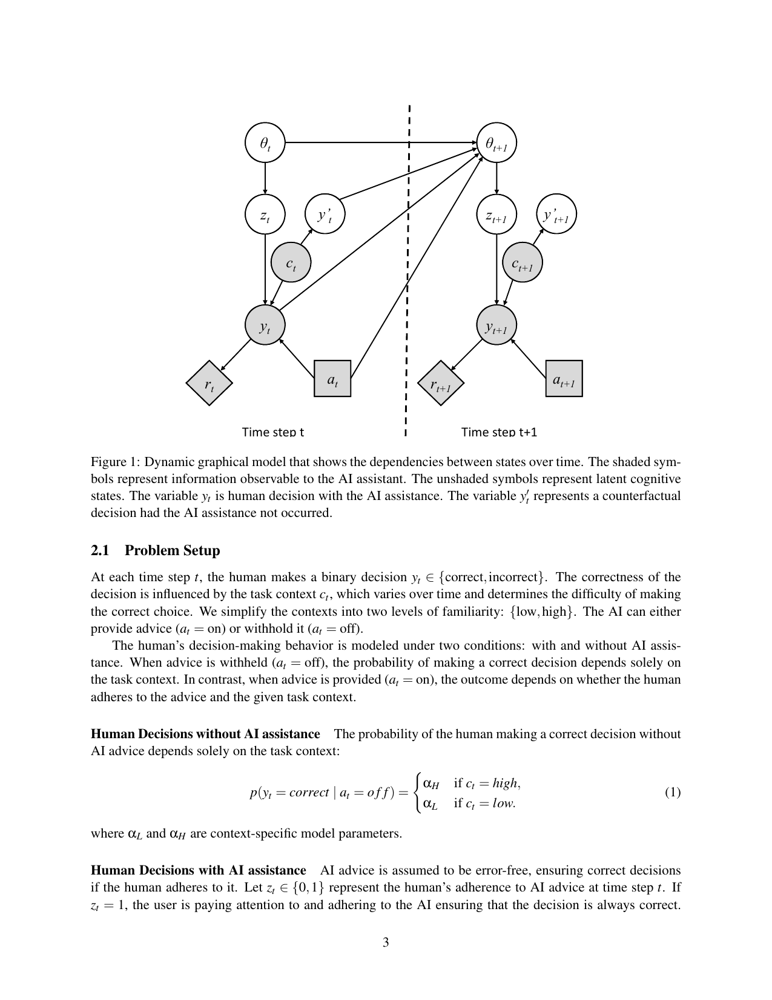
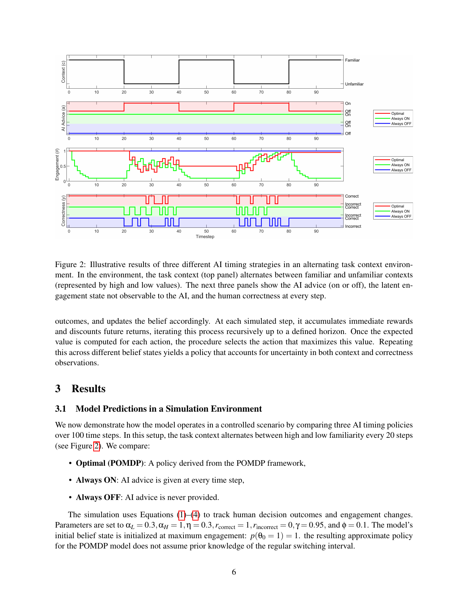
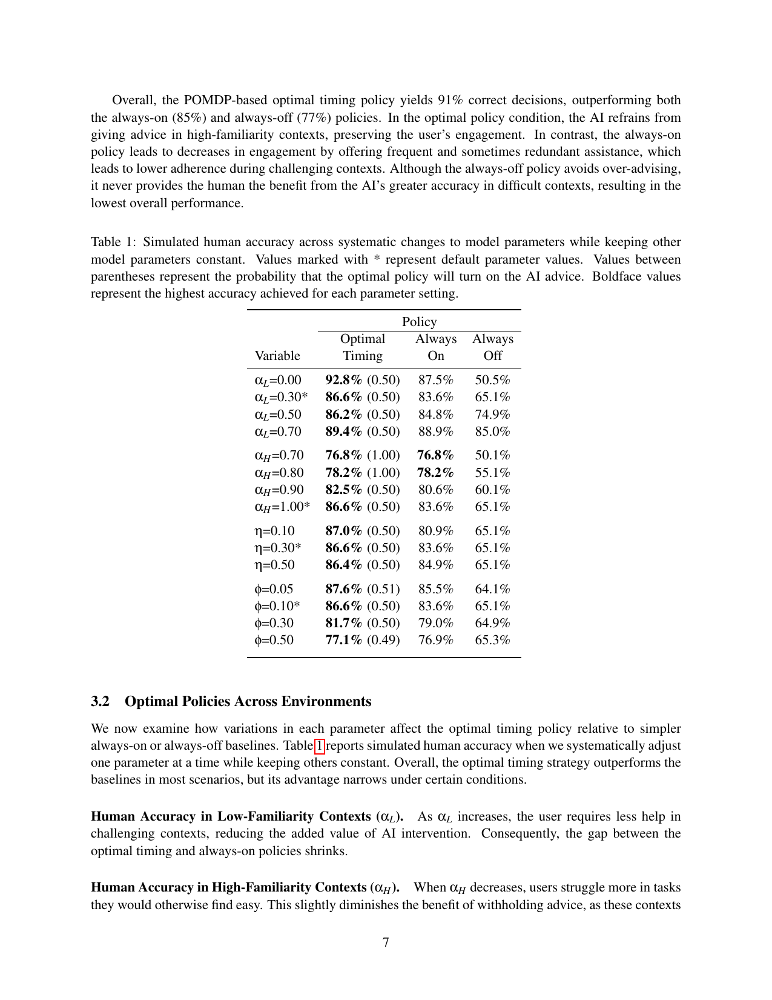

> [!info] 论文信息
> **题目**：When not to help: planning for lasting human-AI collaboration（何时不应提供帮助：为持久的人机协作进行规划）  
> **作者**：Mark Steyvers；Lukas Mayer  
> **机构**：University of California, Irvine  
> **版本**：arXiv:2508.01837v1，2025-08-03  
> **论文类型**：人机交互（Human–Computer Interaction, HCI）/认知建模（Cognitive Modeling）/序贯决策（Sequential Decision-Making）  
> **核心问题**：AI 什么时候应该提供帮助，什么时候应该保持沉默？

## 一句话结论

AI 不应追求“每次都帮忙”。论文提出一个基于**部分可观测马尔可夫决策过程（Partially Observable Markov Decision Process, POMDP）的认知建模框架：AI 根据任务熟悉度、用户可能的参与状态（engagement state）以及过去建议是否真正有用，决定当前是否提供建议，从而在短期正确率与长期用户参与度之间取得平衡。

## 1. 摘要与研究动机

实时与人互动的 AI 系统面临两个相反目标：

1. 在用户确实需要时及时提供帮助；
2. 避免在简单、熟悉或用户本来就能做对的情境中反复提醒。

如果 AI 过度提醒，用户可能产生**提醒疲劳（alert fatigue）**，逐渐忽略提醒、降低信任，甚至关闭系统。这样会导致一个反直觉结果：AI 在短期内提供了更多帮助，却损害了未来用户采纳高质量建议的概率。

论文的核心思想是把“是否帮助”建模为一个长期决策问题。AI 不只问“现在给建议能否让用户做对”，还要问：**这次建议会不会让用户以后不再听我的建议？**

## 2. 术语表（Terminology Ledger）

| 中文            | English                                             | 本文中的含义                      |
| ------------- | --------------------------------------------------- | --------------------------- |
| 人机协同          | human-AI collaboration                              | 人与 AI 长期共同完成任务              |
| AI 辅助         | AI assistance                                       | AI 提供建议、提醒或决策支持             |
| 参与度/投入度       | engagement                                          | 用户关注、信任并采纳 AI 建议的程度         |
| 遵从/采纳         | adherence                                           | 用户实际听取并按照 AI 建议行动           |
| 潜在认知状态        | latent cognitive state                              | AI 无法直接观察、只能推断的用户心理状态       |
| 反事实决策         | counterfactual decision                             | 假设 AI 没有提供帮助时，用户本来会做出的决定    |
| 任务情境          | task context                                        | 当前任务环境；本文简化为高熟悉度或低熟悉度       |
| 高熟悉度情境        | high-familiarity context                            | 用户通常能够独立做对的任务情境             |
| 低熟悉度情境        | low-familiarity context                             | 用户独立完成时更容易出错的任务情境           |
| 自适应策略         | adaptive strategy                                   | 根据用户状态和历史互动动态决定是否帮助         |
| 基准策略          | baseline policy                                     | 用于比较的简单策略，如始终开启或始终关闭        |
| 部分可观测马尔可夫决策过程 | Partially Observable Markov Decision Process, POMDP | 在只能看到部分状态时进行长期序贯决策的框架       |
| 贝叶斯建模         | Bayesian modeling                                   | 用概率和信念状态表示不确定性，并根据观察更新信念    |
| 前向搜索          | forward search                                      | 枚举候选动作、模拟未来观察并估计累计回报        |
| 折扣因子          | discount factor, γ                                  | 控制未来回报相对于当前回报的重要程度          |
| 理论心智          | theory of mind                                      | 推断他人的信念、意图、知识或心理状态          |
| 关闭开关问题        | off-switch problem                                  | 研究 AI 如何允许人类停止或关闭系统而不破坏长期目标 |

## 3. 论文创新点

### 3.1 把“何时帮助”与“长期参与度”统一建模

以往基于效用的 AI 辅助方法通常预先指定干预成本，例如提醒一次需要付出多少代价。本文将过度建议的代价放入用户参与度动态中：如果建议经常是冗余的，用户的参与度会自然下降；参与度下降后，用户在真正困难的任务中也可能不再遵从 AI。

### 3.2 引入反事实比较

每一次 AI 建议都同时考虑两个结果：

- 实际结果：AI 提供建议后用户做得怎样；
- 反事实结果：如果 AI 没有建议，用户本来会做得怎样。

如果用户本来就能做对，建议可能是冗余的；如果用户本来会做错，而 AI 帮助其做对，则建议具有高价值。这个比较直接决定参与度是下降还是上升。

### 3.3 将不可直接观察的用户参与度纳入 POMDP

AI 可以观察任务情境和用户最终决策是否正确，但不能直接观察用户是否真正关注、是否信任 AI。因此，用户参与度与建议遵从状态被视为**潜变量（latent variables）**，AI 通过历史观察维护对这些变量的信念。

### 3.4 用“策略性沉默”保护未来的帮助效果

在高熟悉度情境下，最优策略可能是暂时不说话。沉默不是系统失效，而是为了保存用户对未来关键建议的接受度。

## 4. 总体模型结构

论文将人机互动表示为一个离散时间过程。每个时间步 $t$，AI 观察当前任务情境和用户决策，然后选择开启或关闭建议。

> **图 1（Figure 1）说明**：阴影变量表示 AI 可以观察到的信息；非阴影变量表示潜在认知状态。$y_t$ 是提供 AI 辅助时用户的实际决策，$y'_t$ 是没有 AI 辅助时用户本来会做出的反事实决策。

## 5. 问题设定与变量

### 5.1 任务情境与用户决策

用户在每个时间步做二元决策：

$$y_t \in \{\text{correct},\ \text{incorrect}\}$$

任务情境 $c_t$ 被简化为两种熟悉度：

$$c_t \in \{\text{low},\ \text{high}\}$$

AI 的动作是：

$$a_t \in \{\text{on},\ \text{off}\}$$

其中，$a_t=\text{on}$ 表示提供建议，$a_t=\text{off}$ 表示不提供建议。

### 5.2 没有 AI 辅助时的正确率

没有建议时，用户正确决策的概率只取决于任务情境：

$$
p(y_t=\text{correct}\mid a_t=\text{off})=
\begin{cases}
\alpha_H, & c_t=\text{high}\\
\alpha_L, & c_t=\text{low}
\end{cases}
$$

- $\alpha_H$：高熟悉度情境下用户独立完成任务的正确率；
- $\alpha_L$：低熟悉度情境下用户独立完成任务的正确率。

通常假设 $\alpha_H > \alpha_L$，表示用户在熟悉任务中更擅长。

### 5.3 有 AI 辅助时的正确率

设 $z_t \in \{0,1\}$ 表示用户是否遵从 AI 建议：

- $z_t=1$：用户关注并遵从 AI；
- $z_t=0$：用户忽略 AI，独立做决定。

论文假设 AI 建议本身无误。因此：

$$
p(y_t=\text{correct}\mid a_t=\text{on})=
\begin{cases}
1, & z_t=1\\
p(y_t=\text{correct}\mid a_t=\text{off}), & z_t=0
\end{cases}
$$

这意味着 AI 的帮助是否有效，关键不只在于 AI 能否给出正确建议，还在于用户是否愿意听取建议。

## 6. 用户参与度动态

### 6.1 遵从概率

用户参与度用连续变量 $\theta_t$ 表示，范围为 $[0,1]$。它决定用户遵从 AI 建议的概率：

$$z_t \sim \operatorname{Bernoulli}(\theta_t)$$

因此，$\theta_t$ 越高，用户越可能采纳 AI 建议。

### 6.2 参与度更新公式

用户参与度根据实际决策 $y_t$、反事实决策 $y'_t$ 以及 AI 是否提供建议进行更新：

$$
\theta_{t+1}=
\begin{cases}
\theta_t(1-\eta), & a_t=\text{on},\ y_t=\text{correct},\ y'_t=\text{correct}\\
\theta_t+(1-\theta_t)\eta, & a_t=\text{on},\ z_t=1,\ y_t=\text{correct},\ y'_t=\text{incorrect}\\
\theta_t+(1-\theta_t)\eta, & a_t=\text{on},\ z_t=0,\ y_t=\text{incorrect}\\
\theta_t, & a_t=\text{off},\ y_t=\text{correct}\\
\theta_t+(1-\theta_t)\eta, & a_t=\text{off},\ y_t=\text{incorrect}
\end{cases}
$$

$\eta$ 是参与度调整速率。

直观解释：

| 情况 | 用户学到的东西 | $\theta$ 的变化 |
|---|---|---|
| AI 建议是冗余的，用户本来就能做对 | AI 没有增加价值 | 下降 |
| AI 纠正了用户本来会犯的错误 | AI 很有用 | 上升 |
| AI 给了建议但用户没听，最后做错 | 用户意识到自己需要 AI | 上升 |
| 没有 AI，用户独立完成且做对 | 没有理由改变参与度 | 不变 |
| 没有 AI，用户做错 | 用户可能更依赖 AI | 上升 |

该公式是全文最关键的机制：**过度建议的代价不是人为添加的惩罚项，而是由用户参与度下降自然产生的长期损失。**

> [!warning] 模型假设
> 论文假设用户能够区分“实际结果”和“如果没有 AI 时本来会发生的反事实结果”。现实中用户未必能准确知道自己本来会不会做错，因此这是一个需要行为实验验证的重要假设。

## 7. 任务情境动态

任务情境在相邻时间步之间发生切换。每一步有概率 $\phi$ 在低熟悉度和高熟悉度之间切换：

$$
p(c_{t+1}\neq c_t)=\phi
$$

$\phi$ 越大，环境变化越频繁；$\phi$ 越小，某一类情境持续时间越长。

## 8. POMDP 形式化

整个问题被定义为 POMDP 元组：

$$\langle S,A,T,R,O,Z,\gamma\rangle$$

### 8.1 状态空间（State Space, $S$）

$$S=\langle c,y,z,\theta\rangle$$

包含任务情境 $c$、用户决策 $y$、建议遵从状态 $z$ 和参与度 $\theta$。其中 $c$ 和 $y$ 可被 AI 观察，$z$ 和 $\theta$ 通常不可直接观察。

### 8.2 动作空间（Action Space, $A$）

$$A=\{\text{on},\text{off}\}$$

AI 在每个时间步选择提供或不提供建议。

### 8.3 转移模型（Transition Model, $T$）

$$T(s,a,s')$$

表示在当前状态 $s$ 和动作 $a$ 下转移到下一状态 $s'$ 的概率。转移由用户决策模型、参与度更新公式和情境切换过程共同决定。

### 8.4 奖励函数（Reward Function, $R$）

$$
R(s,a)=
\begin{cases}
r_{\text{correct}}, & y=\text{correct}\\
r_{\text{incorrect}}, & y=\text{incorrect}
\end{cases}
$$

且 $r_{\text{correct}}>r_{\text{incorrect}}$。论文的基础模拟中使用 $r_{\text{correct}}=1$、$r_{\text{incorrect}}=0$。

### 8.5 观察空间与观察模型

AI 观察到：

$$O=\langle c,y\rangle$$

AI 能看到任务情境和用户决策，但看不到完整的心理状态。观察模型：

$$Z(o\mid s',a)$$

描述在新状态和动作给定时观察到 $o$ 的概率。

### 8.6 折扣累计回报

策略 $\pi(a\mid o)$ 根据观察决定动作，并最大化：

$$
\mathbb{E}\left[\sum_{t=0}^{\infty}\gamma^tR(s_t,a_t)\right]
$$

$\gamma\in[0,1]$ 是折扣因子。$\gamma$ 越高，AI 越重视长期用户参与度及未来正确率；$\gamma$ 越低，AI 越偏向眼前正确率。

## 9. 策略估计算法

论文没有直接求解连续状态空间中的精确最优 POMDP，而是采用近似方法。

### 9.1 离散化参与度

将连续的 $\theta\in[0,1]$ 划分为 $K$ 个区间。模拟中：

$$K=20$$

离散化后，状态空间由离散变量构成，便于计算。

### 9.2 基于信念状态的前向搜索

算法从当前**信念状态（belief state）**开始：

1. 枚举每一个候选动作：开启或关闭 AI 建议；
2. 模拟可能出现的观察结果；
3. 根据观察更新对隐藏状态的信念；
4. 累积即时奖励，并用 $\gamma$ 折扣未来奖励；
5. 递归搜索到预先设定的规划深度；
6. 选择期望累计回报最高的动作；
7. 在不同信念状态下重复上述过程，得到近似策略。

这种方法的关键不是记住固定的“熟悉任务不帮助、困难任务帮助”规则，而是根据不确定的用户状态和历史行为动态规划。

## 10. 关键图表与结果

### 10.1 图 2：三种时机策略

> **图 2（Figure 2）** 展示了 100 个时间步中三种量的变化：任务情境、AI 是否提供建议、不可观测的参与度以及用户正确率。任务情境每 20 步在高熟悉度和低熟悉度之间交替。

比较的三种策略：

- **Optimal (POMDP)**：由 POMDP 计算得到的近似最优策略；
- **Always ON**：每一步都提供 AI 建议；
- **Always OFF**：从不提供 AI 建议。

模拟参数：

| 参数              | 含义              |   设置 |
| --------------- | --------------- | ---: |
| $\alpha_L$      | 低熟悉度情境下的独立正确率   |  0.3 |
| $\alpha_H$      | 高熟悉度情境下的独立正确率   |  1.0 |
| $\eta$          | 参与度调整速率         |  0.3 |
| $r_{correct}$   | 做对的奖励           |    1 |
| $r_{incorrect}$ | 做错的奖励           |    0 |
| $\gamma$        | 折扣因子            | 0.95 |
| $\phi$          | 情境切换概率          |  0.1 |
| 初始参与度           | $p(\theta_0=1)$ |    1 |

论文特别指出，POMDP 策略并不知道环境会严格每 20 步切换，而是根据当前观察和信念进行决策。

### 10.2 主结果

在 100 个时间步的模拟中：

| 策略              |   用户正确率 |
| --------------- | ------: |
| Optimal / POMDP | **91%** |
| Always ON       |     85% |
| Always OFF      |     77% |

解释：

- **POMDP 最优时机策略**：在高熟悉度情境中通常不提供建议，以保存参与度；在困难情境中提供帮助，因此长期正确率最高。
- **Always ON**：短期帮助很多，但冗余建议持续消耗参与度，导致用户在真正困难的情境中遵从率下降。
- **Always OFF**：不会造成过度建议，却完全放弃了 AI 在困难任务中的准确性优势，因此整体表现最低。

### 10.3 图 2 后续参数表：敏感性分析

表 1 每次只改变一个参数，其余参数保持不变；括号内是最优策略开启 AI 建议的概率，粗体代表该参数设定下的最高准确率。

| 改变的参数           | Optimal Timing | Always ON | Always OFF |
| --------------- | -------------: | --------: | ---------: |
| $\alpha_L=0.00$ |      **92.8%** |     87.5% |      50.5% |
| $\alpha_L=0.30$ |      **86.6%** |     83.6% |      65.1% |
| $\alpha_L=0.50$ |      **86.2%** |     84.8% |      74.9% |
| $\alpha_L=0.70$ |      **89.4%** |     88.9% |      85.0% |
| $\alpha_H=0.70$ |          76.8% | **76.8%** |      50.1% |
| $\alpha_H=0.80$ |          78.2% | **78.2%** |      55.1% |
| $\alpha_H=0.90$ |      **82.5%** |     80.6% |      60.1% |
| $\alpha_H=1.00$ |      **86.6%** |     83.6% |      65.1% |
| $\eta=0.10$     |      **87.0%** |     80.9% |      65.1% |
| $\eta=0.30$     |      **86.6%** |     83.6% |      65.1% |
| $\eta=0.50$     |      **86.4%** |     84.9% |      65.1% |
| $\phi=0.05$     |      **87.6%** |     85.5% |      64.1% |
| $\phi=0.10$     |      **86.6%** |     83.6% |      65.1% |
| $\phi=0.30$     |      **81.7%** |     79.0% |      64.9% |
| $\phi=0.50$     |      **77.1%** |     76.9% |      65.3% |

## 11. 参数影响的完整解读

### 11.1 低熟悉度正确率 $\alpha_L$

随着 $\alpha_L$ 增大，用户在困难情境中本来就更容易做对，因此 AI 干预的附加价值下降。于是 Optimal Timing 与 Always ON 的差距缩小。

### 11.2 高熟悉度正确率 $\alpha_H$

当 $\alpha_H$ 降低时，用户在原本熟悉的任务中也更容易出错。此时保持沉默的收益下降，Always ON 可能接近或达到最优策略。

### 11.3 参与度调整速率 $\eta$

$\eta$ 越高，用户从低参与度状态恢复得越快，频繁建议造成的负面影响持续时间越短。因此 Optimal Timing 相对 Always ON 的优势会减弱。

### 11.4 情境切换概率 $\phi$

作者原本预期：较慢的情境切换会给自适应策略提供更稳定的时间窗口，从而扩大优势。但表 1 并未清晰支持这一假设。可能原因是用户参与度动态，以及 $\alpha_L$ 和 $\alpha_H$ 的差异，对最终准确率的影响大于 $\phi$。

总体而言，策略性建议的效果主要取决于：

1. 用户能力：$\alpha_L,\alpha_H$；
2. 参与度变化速度：$\eta$；
3. 环境变化频率：$\phi$，影响相对较小。

## 12. 与相关理论的关系

### 12.1 与理论心智（Theory of Mind）的关系

AI 通过观察行为推断用户是否投入、是否认为建议有用，以及未来是否会遵从建议。这与理论心智相似：AI 试图建立用户内部认知状态的模型，并据此预测用户行为。

### 12.2 与关闭开关问题（Off-Switch Problem）的关系

关闭开关问题关注 AI 如何允许人类覆盖或关闭自己，同时不破坏 AI 的目标追求。本文关注的是更隐性的“自我约束”：AI 在熟悉或冗余的情境中主动减少干预，避免用户逐渐脱离。

二者共同强调：AI 的行为必须与人的意图和长期协作目标保持一致。

## 13. 论文的评估方式与证据边界

### 13.1 已完成的评估

- 构建了明确的认知建模框架；
- 用 POMDP 表达部分可观测、长期序贯决策问题；
- 通过前向搜索近似求解策略；
- 在 100 步模拟环境中比较 POMDP、Always ON、Always OFF；
- 对 $\alpha_L$、$\alpha_H$、$\eta$、$\phi$ 做单参数敏感性分析；
- 观察用户正确率与参与度之间的权衡。

### 13.2 尚未完成的评估

论文明确说明目前**没有行为实验（behavioral study）来验证认知模型的关键假设。因此，91%、85%、77% 是模型模拟结果，不是现实用户实验中测得的统计结果。

尤其需要实证检验：

- 用户是否能识别 AI 建议是否真正帮助了自己；
- 冗余建议是否确实按照公式使 $\theta$ 下降；
- 用户忽略建议并犯错后，参与度是否会上升；
- AI 建议是否现实中总能被视为“无误”；
- 用户是否会因为短期不提供帮助而认为系统失效。

## 14. 局限与未来工作

1. **AI 建议被假设为无误**：现实系统可能犯错，用户也可能错误地遵从 AI。
2. **参与度状态过于简化**：只用一个 $\theta$ 表示复杂的信任、注意力、依赖和满意度。
3. **用户能够观察反事实结果**：现实用户通常不知道自己在没有 AI 时会不会做错。
4. **任务情境只有两种熟悉度**：真实任务往往具有连续难度、多维上下文和结构变化。
5. **离散化与前向搜索是近似**：$K=20$ 的分箱会损失连续状态信息，搜索深度也会影响策略质量。
6. **没有个体化学习**：不同用户对冗余建议的敏感度不同，需要学习个人参与度曲线。
7. **没有长期真人实验**：尚不能证明模拟中的参与度保护机制能迁移到真实人机交互。

作者提出的扩展包括：永久脱离阈值、在不确定情境下仍然遵从的用户模型、用户个体差异建模、识别最容易造成脱离的任务情境，以及建立个性化参与度画像。

## 15. 对人机协同系统设计的启示

### 设计原则 1：不要把“帮助次数”当作系统价值

帮助越多不等于系统越好。评价 AI 时应同时考虑当前正确率、未来采纳率和长期任务收益。

### 设计原则 2：先判断用户是否需要，再决定是否输出

系统应估计用户在没有 AI 时的表现，而不是见到每个潜在风险就提醒。

### 设计原则 3：在低价值情境中保持沉默

如果用户几乎必然能做对，重复提醒可能降低未来真正需要帮助时的有效性。

### 设计原则 4：建立用户状态模型

用户的注意力、信任和遵从并非固定不变，应根据互动历史动态估计。

### 设计原则 5：把长期指标纳入评估

除任务准确率外，还应评估：

- 建议采纳率；
- 用户主动关闭率；
- 关键场景中的响应率；
- 冗余提醒比例；
- 长期信任和依赖变化；
- 不同用户之间的公平性与个体适配效果。

## 16. 最终总结

这篇论文提出的不是一个更强的“建议生成器”，而是一个**建议时机控制器（advice timing controller）**。它的创新在于把 AI 的沉默也视为一种有价值的动作：当用户不需要帮助时暂不干预，能够保存参与度，使 AI 在用户真正需要时更可能被听取。

论文通过 POMDP、潜在参与度状态、反事实决策和前向搜索，将“不要过度帮助”从经验性设计建议转化为可计算的长期决策问题。模拟结果支持这一点，但由于尚缺乏真人行为实验，当前结论应理解为一个有潜力的理论与计算框架，而不是已经完成现实验证的产品方案。

## 17. 参考文献线索

- Amershi et al. (2019). *Guidelines for Human-AI Interaction*.
- Ancker et al. (2017). *Effects of workload, work complexity, and repeated alerts on alert fatigue in a clinical decision support system*.
- Horvitz (1999). *Principles of Mixed-Initiative User Interfaces*.
- Horvitz et al. (2003). *Models of Attention in Computing and Communication*.
- Hadfield-Menell et al. (2017). *The Off-Switch Game*.
- Rabinowitz et al. (2018). *Machine Theory of Mind*.

---

**原始 PDF**：`/Users/dingdingdang/Desktop/2508.01837v1.pdf`  
**关键图页**：第 3 页（图 1）、第 6 页（图 2）、第 7 页（表 1）
